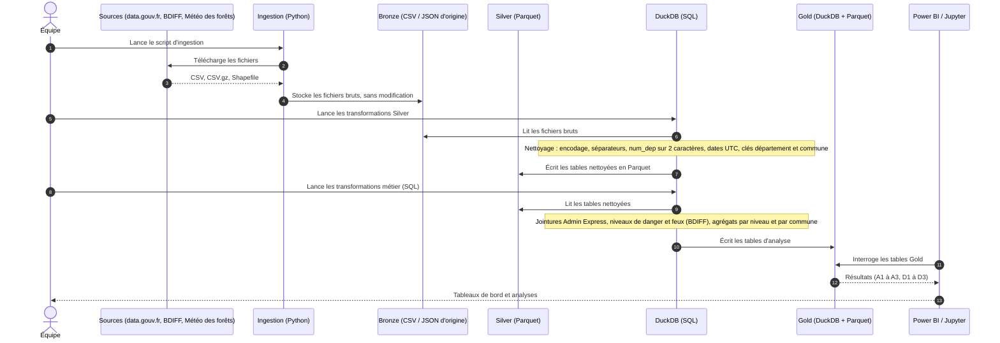

Les seuils se calculs en fonctions de l'Indice Forêt Météo  (IFM)
Quatres couleurs : vert, jaune, orange et rouge
Cependant, une même valeur d’IFM peut conduire à une appréciation différente selon le département, la saison, la végétation et la répartition géographique du danger.

## Diagramme de séquence : entrepôt de données (Bronze / Silver / Gold)

