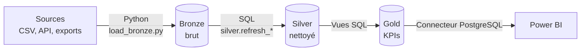
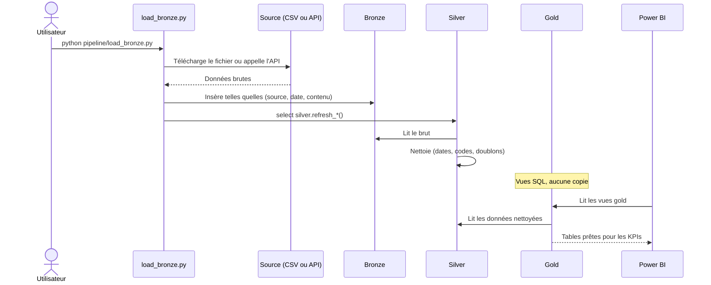

# Pipeline de données

Les données passent par trois couches dans Supabase (PostgreSQL), de la plus brute à la plus prête pour Power BI.

| Couche | Rôle | Exemple | Règle |
|---|---|---|---|
| **Bronze** | Copie brute de la source, telle que reçue | `bronze.raw_rows`, `bronze.api_calls` | On n'y modifie jamais rien |
| **Silver** | Données nettoyées et typées | `silver.meteo_foret`, `silver.commune` | Dates en `date`, codes sur 2 ou 5 caractères, doublons supprimés |
| **Gold** | Vues prêtes pour les KPIs et Power BI | `gold.meteo_occitanie` | Lecture seule, filtrées sur Occitanie |

## Vue d'ensemble

## Séquence d'un chargement

## Pourquoi trois couches

- **Bronze** garde la preuve de ce qu'on a reçu : on peut tout retraiter sans retélécharger.
- **Silver** corrige les formats une seule fois, au même endroit pour tout le monde.
- **Gold** calcule les KPIs en SQL, donc Power BI n'a plus qu'à afficher.

## Utilisation

1. Copier `.env.example` en `.env` et renseigner le mot de passe (le fichier est ignoré par Git).
2. `pip install -r pipeline/requirements.txt`
3. `python pipeline/load_bronze.py` (ou `python pipeline/load_bronze.py meteo_foret` pour une seule source).

Les sources sont listées dans `sources.yml`. Les migrations SQL sont dans `supabase/migrations/`.
